# Munadi

## Your Simple and Beautiful Athan App

Munadi is a simple yet powerful Athan app designed to be a companion in your daily life. It offers a
clean, beautiful interface free from advertisements and tracking, delivering precise prayer alerts
for any city worldwide. The app includes dual calendar support (Gregorian & Hijri), multiple
calculation methods, and the ability to view prayer schedules for any date - past or future. A range
of thoughtful settings allows you to tailor the experience to your personal needs.

**Features:**

- Prayer times for nearly any city around the globe
- Qibla direction for current location
- Countdown to the next prayer, also visible in tooltips
- View prayer times for past or future dates
- Support for various global calculation methods
- Flexible time format options
- Fine-tune prayer times and Hijri date offsets
- Option to assign a unique and custom athan for each prayer
- Individual control to enable, mute, or adjust athan volumes
- Lightweight design with no advertisements or tracking
- Automatic switching between Dark and Light themes
- Customizable UI visual effects
- Dynamic wallpapers that reflect the time of prayer
- Language choices from Arabic and Bangla, with complete RTL layout support
- Convenient system-tray support

## Screenshots

### Version 26.11

<div style="overflow-x: auto; white-space: nowrap;">

| 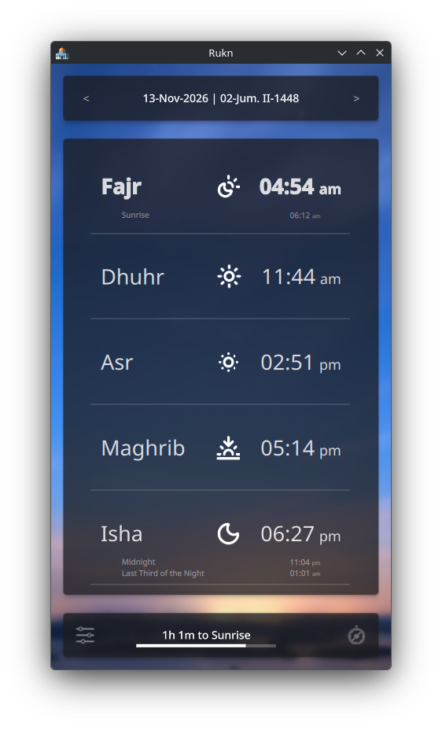 | 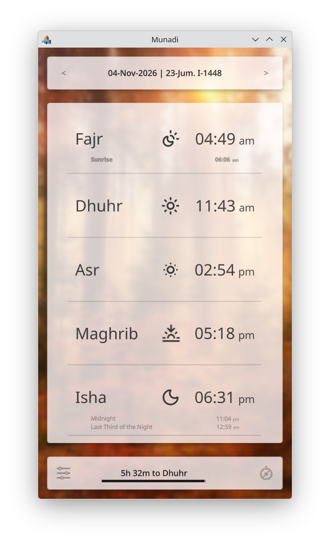 | 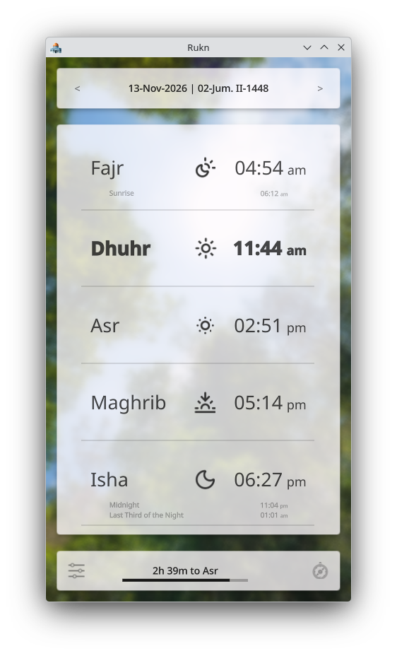 | 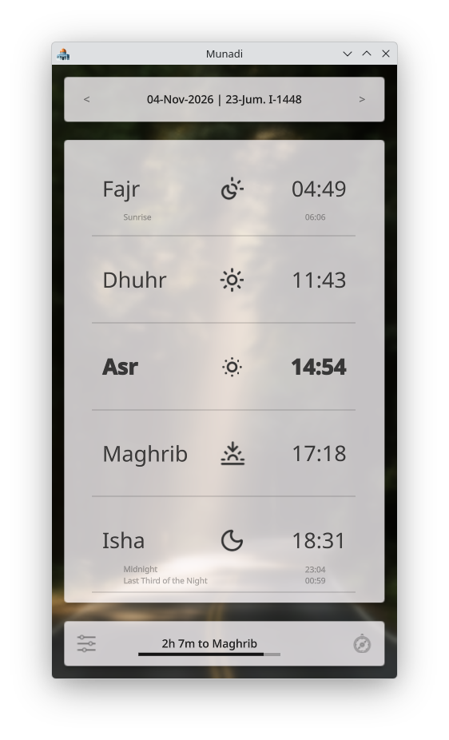 | 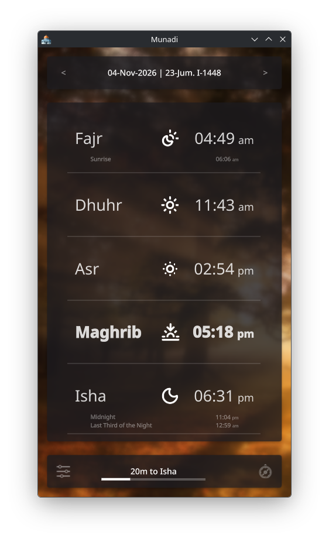 | 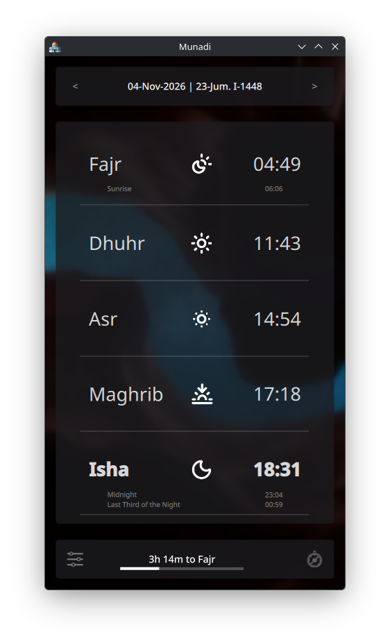 |
| :--------------------------------------------: | :--------------------------------------------------: | :----------------------------------------------: | :------------------------------------------: | :--------------------------------------------------: | :--------------------------------------------: |
|                      Fajr                      |                       Sunrise                        |                      Dhuhr                       |                     Asr                      |                       Maghrib                        |                      Isha                      |

| 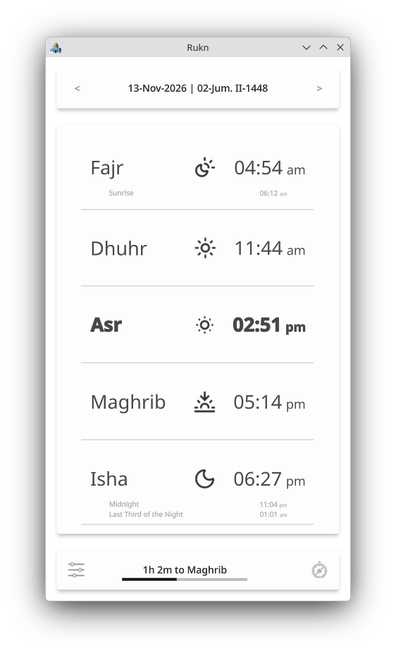 | 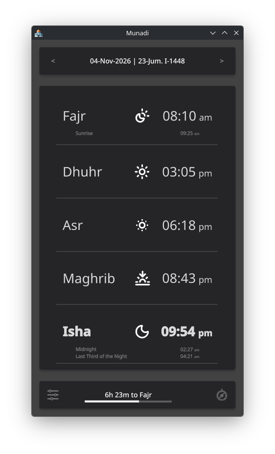 | 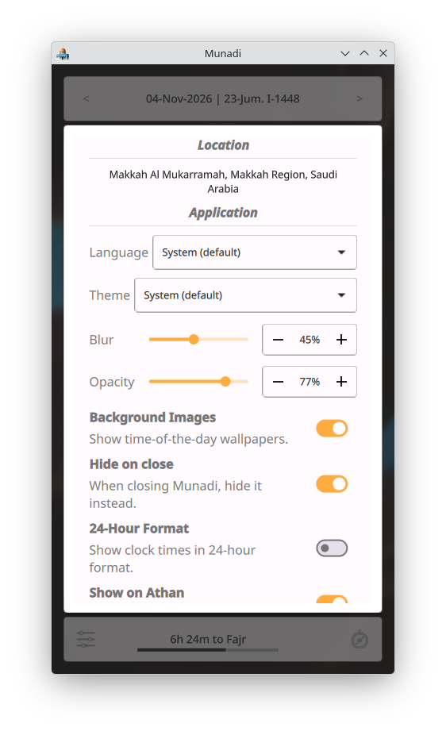 | 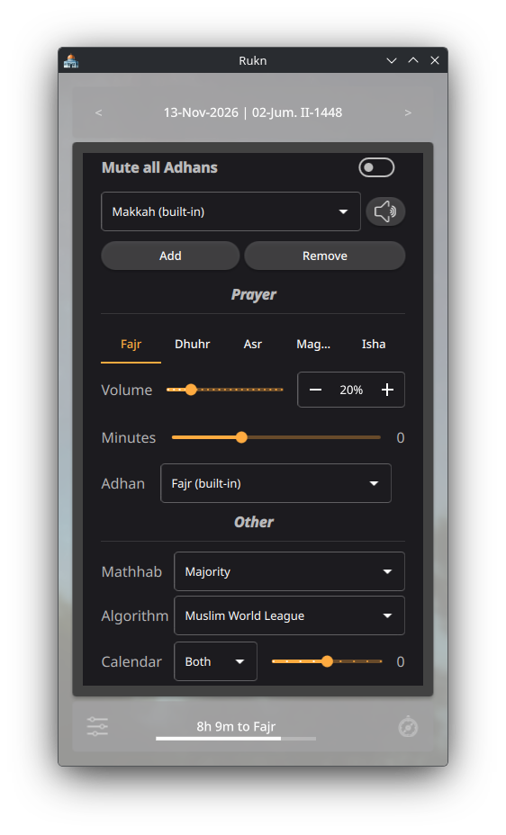 |
| :----------------------------------------------------------: | :--------------------------------------------------------: | :-------------------------------------------------------: | :------------------------------------------------------: |
|                        Material Light                        |                       Material Dark                        |                   Settings Page (Dark)                    |                  Settings Page (Light)                   |

| 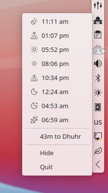 | 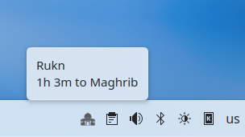 |
| :------------------------------------------: | :------------------------------------------------: |
|                  Tray Menu                   |                      Tooltip                       |

</div>

## Status

| Packaging | Platform                      |                                                                                      Status                                                                                       |
| --------- | ----------------------------- | :-------------------------------------------------------------------------------------------------------------------------------------------------------------------------------: |
| Makeself  | linux/x86_64                  |                        [](https://gitlab.com/munadi/munadi/-/commits/26.11)                         |
| Flatpak   | linux/x86_64<br>linux/aarch64 | [](https://github.com/flathub-infra/vorarbeiter/actions/workflows/build.yml) |
| APK       | android/arm64-v8a             |                                                                                       Alpha                                                                                       |

> [!Note]
>
> The self-extracting makeself installer is the preferred method.

## Installing

### Primary Release

**Munadi Self-Extracting Installer**

[](https://gitlab.com/munadi/munadi/-/releases)

No dependencies required - just download & install:

```bash
# Replace VER with the file's version, e.g. Munadi-26.11.run
sh Munadi-<VER>.run -q
```

Alternatively:

```bash
sh ./Munadi-<VER>.run
```

and follow instructions.

### Other Sources

<div align="center">
  <a href='https://flathub.org/apps/details/org.munadi.Munadi'>
    
  </a>
</div>

## Contributing and Building from Source

See [CONTRIBUTING](CONTRIBUTING.md) for details about building the app and development notes

## Bug Reports

First of all, see if the issue you're facing already exists on the board. If not, follow these
workflow before reporting bugs:

**_If using self-extracting installer_**

1. Install the app using the self-extracting archive:

```bash
MUNADI_DEBUG=1 sh Munadi-<ver>.run
```

Note the log location printed after (hopefully) successful installation. Retain it on a good place.

2. Remove old configs and caches:

```bash
rm -rf ~/.cache/[mM]unadi
mv ~/.config/munadi{,.bak}
```

3. Do

```bash
QT_LOGGING_RULES='*.debug=true;qt.*.debug=false;qt.qml.import=true' \
  munadi > munadi.log 2>&1
```

and try reproducing the issues

**_If using flatpak version_**

1. Run `flatpak update --appstream` and `flatpak update -y`
2. Remove old configs and caches:

```bash
mv ~/.var/app/org.munadi.Munadi{,.bak}
```

3. Run from terminal:

```bash
flatpak run \
  --command=munadi \
  --env=QT_LOGGING_RULES='*.debug=true;qt.*.info=true;kf.*.debug=false;qt.qml.import=true' \
  org.munadi.Munadi > munadi-log.txt 2>&1
```

and try reproducing the issues.

If issues persist, [open an issue](https://gitlab.com/munadi/munadi/-/work_items) with `munadi.log`,
the install logs you retained earlier and the one in the CWD when installing. Explain as detail as
possible with your current app version and relevant distro details.

## License

This project is licensed under the AGPL-3.0-or-later license. FFmpeg is built on the default LGPL
license. Licenses apply to individual tools used in this project. See the [LICENSE](LICENSE) file
for details, and [Acknowledgements](#acknowledgements) for licenses for used libraries.

- **Homepage**: [munadi.org](https://munadi.org)
- **Bug Tracker**: [Issues](https://gitlab.com/munadi/munadi/-/issues) |
  [Flathub Issues](https://github.com/flathub/org.munadi.Munadi/issues)
- **Source Code**: [Source](https://gitlab.com/munadi/munadi) |
  [Flathub](https://github.com/flathub/org.munadi.Munadi)

## Acknowledgements

### Libraries used in this project

- **Adhan-C++** by Lotconn Inc.
  - Project Implementation: Prayer times calculations
  - License: MIT
  - Homepage: <https://lotconn.org/>
  - Source: <https://github.com/lotconn/adhan-cpp>
  - Mirror (Codeberg): <https://codeberg.org/lotconn/adhan-cpp>

- **Android Openssl** by Klarälvdalens Datakonsult AB
  - Project Implementation: SSL library for Android builds
  - License: Apache
  - Source: <https://github.com/KDAB/android_openssl>

- **FileMan** by Lotconn Inc.
  - Project Implementation: File management backend
  - License: MIT
  - Homepage: <https://lotconn.org/>
  - Source: <https://gitlab.com/Lotconn/FileMan>
  - Mirror (Codeberg): <https://codeberg.org/Lotconn/FileMan>

- **makeself** by megastep
  - Project Implementation: Self-extracting installer
  - License: GPL v2
  - Homepage: <https://makeself.io/>
  - Source: <https://github.com/megastep/makeself>

- **Qt** by The Qt Company
  - Project Implementation: UI and core code
  - License: GPL v3 and LGPL v3
  - Homepage: <https://www.qt.io/>
  - Source: <https://code.qt.io/cgit/>

- **SingleApplication** by itay-grudev
  - Project Implementation: Single-instance library
  - License: MIT
  - Reference: <https://itay-grudev.github.io/SingleApplication/>
  - Source: <https://github.com/itay-grudev/SingleApplication>

### Contributors

- **Project Author:** AA [@hakpw](https://gitlab.com/hakpw)
- Hasan Esa [@HasanEsa](https://gitlab.com/HasanEsa)
- Damascene
- Khaled Khamis [@khaledkhamis26](https://gitlab.com/khaledkhamis26)

---

_For historical context, see the [CHANGELOG](CHANGELOG.md)._
