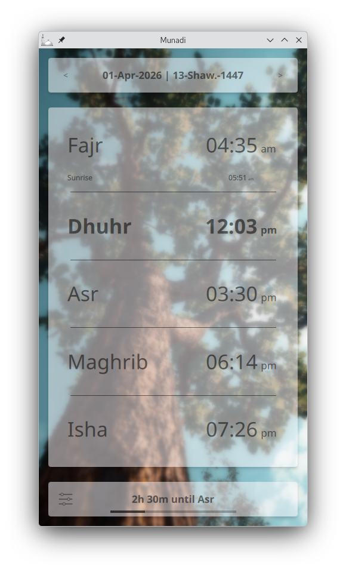
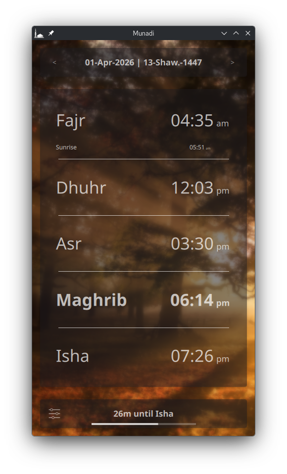
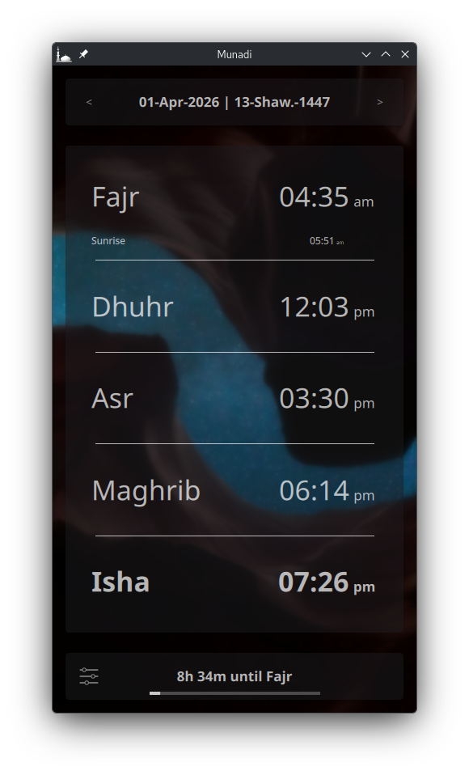
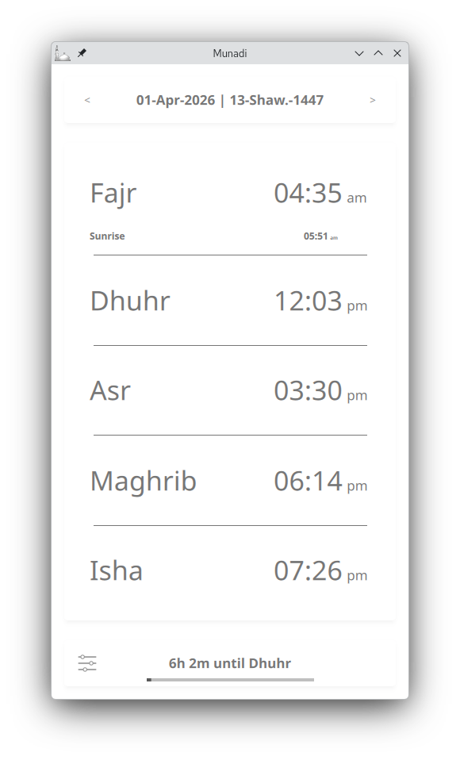
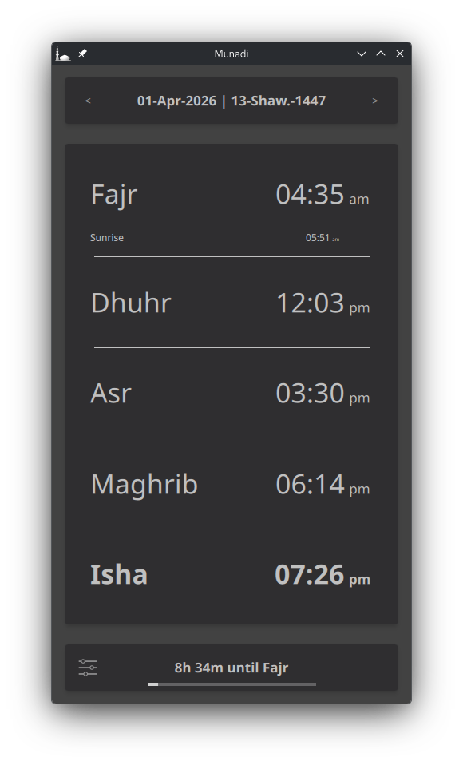
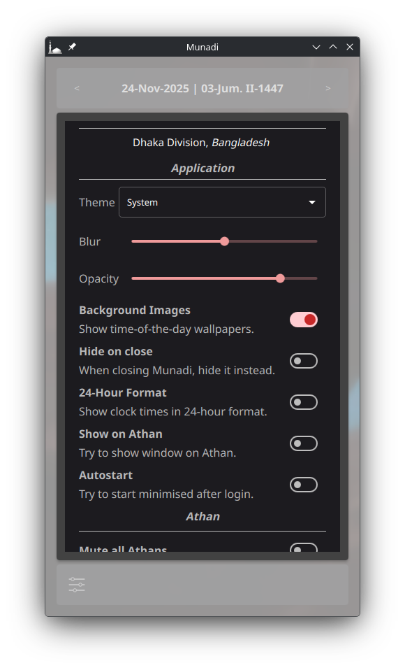
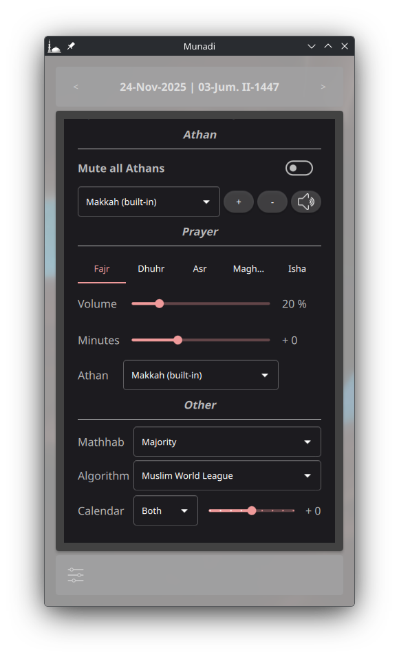
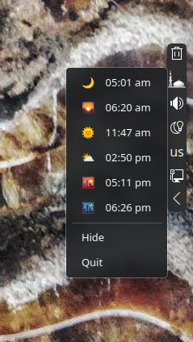
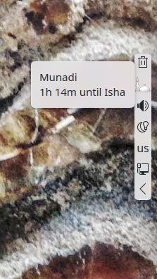

# Munadi

## Simple Athan App

Munadi is a lightweight, privacy-focused prayer time application for Linux and Android. It provides accurate prayer times with customizable athan (call to prayer) options, dual calendar support (Hijri/Gregorian), and a clean modern interface.

---

## Screenshots

### Version 26.04

<div style="overflow-x: auto; white-space: nowrap;">

|  |  |  |  |  |
|:--:|:--:|:--:|:--:|:--:|
| Fajr Prayer Time | Dhuhr Prayer Time | Asr Prayer Time | Maghrib Prayer Time | Isha Prayer Time |

|  |  |  |  |  |  |
|:--:|:--:|:--:|:--:|:--:|:--:|
| Material Light Theme | Material Dark Theme | Location Search | Prayer Times Settings | General Settings | Appearance Settings |

|  |  |
|:--:|:--:|
| System Tray Menu | Tooltip Display |

</div>

---

## Download

### Primary Release

[](https://gitlab.com/HasanEsa/munadi/-/releases)

**Munadi Self-Extracting Installer**

(No dependencies required - just run & install)

```bash
$ curl -JLO https://munadi.org/get/26.04 && bash Munadi-26.04.run -q
```

Alternatively:

```bash
$ curl -JLO https://munadi.org/get/26.04
$ bash ./Munadi-26.04.run
```

and follow instructions.

### Other Sources
<div align="center">
  <a href='https://flathub.org/apps/details/org.munadi.Munadi'>
    
  </a>
</div>

---

## Features

- Prayer times for cities worldwide with multiple calculation methods
- Hijri and Gregorian calendar display
- Customizable athan files and individual prayer volume control
- System tray integration with window show/hide functionality
- Time-left countdown to next prayer
- Time-of-day themed wallpapers
- Dark and light theme support
- RTL language support (including Arabic)

---

## Building from Source

Clone the repo:

```bash
git clone --recursive --depth 1 https://gitlab.com/munadi/munadi.git ./munadi_munadi && cd ./munadi_munadi
```

## 1. Static Build via Docker Image (Recommended)

The recommended production build method is a static build in Docker:

```bash
docker run \
  --name munadi-builder \
  --rm -it \
  -v ./:/src:Z \
  registry.gitlab.com/munadi/munadi/builder:rocky10
```

<details><summary>Further Developer Notes (Click to expand)</summary>

To build docker image locally:
```bash
docker build -t munadi-builder -f pkg/docker/Dockerfile pkg/docker
docker run \
  --name munadi-builder \
  -it -v ./:/src:Z \
  munadi-builder
```

This builds upon a Rocky Linux 10.1 UBI with all the necessary dependencies needed for building static Qt and FFmpeg binaries to be installed under `/usr`.

For the following steps, the built binary remains available under `build/Release`. To test standalone, execute from the host (outside docker container):
```bash
./build/Release/munadi
```
</details>

Then from inside docker:
```bash
#rm -rf ./build  # recommended housekeeping
cmake -S . -B build -G'Ninja Multi-Config' -DCMAKE_BUILD_TYPE=Release && cmake --build build --parallel --config Release
cd pkg/makeself && ./generate_installer
```
A self-extracting archive named `Munadi-<ver>.run` with the built binary will be available under `pkg/makeself`.

For healthy practices, it is recommended to clean `~/.cache/Munadi` and `~/.config/munadi` folders across subsequent builds.

## 2. Dynamic Build as Flatpak

### Prerequisites

**Build tools:**
- CMake 3.30+
- Ninja build system
- ccache (optional, for faster rebuilds)

**Qt 6.11 packages:**
- `qtbase-6.11` (Core, Gui, Widgets, Quick, QuickControls2)
- `qtmultimedia-6.11`
- `qtlocation-6.11`
- `qtpositioning-6.11`

**System libraries:**
- `wayland-devel`
- `libx11-devel`
- `pulseaudio-libs-devel`
- `dbus-devel`
- `libxkbcommon-devel`
- `libglvnd-devel`
- `libinput-devel`

The recommended method is to use `org.flatpak.Builder`.
```bash
# on project root
curl -fsORL https://github.com/flathub/org.munadi.Munadi/raw/refs/heads/master/org.munadi.Munadi.json

flatpak install -y flathub org.flatpak.Builder

# Add the flathub repo user-wide
flatpak remote-add --if-not-exists --user flathub https://dl.flathub.org/repo/flathub.flatpakrepo

# Then build the manifest
flatpak run --command=flathub-build org.flatpak.Builder --install org.munadi.Munadi.json

# Run the app (provided no previous installation of flatpak munadi is present)
flatpak run org.munadi.Munadi
```

<details><summary>Further Developer Notes (Click to expand)</summary>

There are two manifests already present under `pkg/flathub`:
- **`org.munadi.Munadi.json`** — Dynamic build using platform runtimes, closely resembling actual flathub manifest
- **`org.munadi.Munadi-static.json`** — Static Qt linking for experimental sandbox builds

### Dynamic build
```bash
# Build dynamic version with runtimes
flatpak-builder --install-deps-from=flathub --force-clean --ccache ./build/ ./pkg/flathub/org.munadi.Munadi.json

# Run the built app
flatpak-builder --run --env=WAYLAND_DISPLAY="$WAYLAND_DISPLAY" ./build/ ./pkg/flathub/org.munadi.Munadi.json munadi

# Optional: Run outside sandbox for debugging
./build/files/bin/munadi
```

### Static build
```bash
# Build static version with linked libraries
flatpak-builder --install-deps-from=flathub --force-clean --ccache ./build-static/ ./pkg/flathub/org.munadi.Munadi-static.json

# Run the built app
flatpak-builder --run --env=WAYLAND_DISPLAY="$WAYLAND_DISPLAY" ./build-static/ ./pkg/flathub/org.munadi.Munadi-static.json munadi

# Optional: Run outside sandbox for debugging
./build-static/files/bin/munadi
```

### Known Issues:
- Few core features like adding custom adhan doesn't work after app restart due to flatpak sandboxing. Alternatively, use `org.flathub.Builder` for operating the app from a functional sandbox but introduces more clutter.

</details>

## 3. Qt Creator

Qt Creator can be used for debugging and developing standalone builds. It's especially powerful for UI developments.

- Install Qt Creator
- Open CMakeLists.txt in Qt Creator and build

***Tips:*** Build with Debug or RelWithDebInfo configuration to enable QML debugging.

---

## Project Structure

```
.
├── src/              # Application source code
│   ├── cpp/          # C++ backends (alarms, engine, main)
│   └── qml/          # QML UI components
├── pkg/              # Packaging configurations
│   ├── flathub/      # Flatpak manifest and build config
│   ├── snap/         # Snapcraft configuration
│   ├── makeself/     # Self-extracting installer scripts
│   └── docker/       # Dockerfile for munadi builder image
├── xdg/              # Linux desktop integration
│   ├── icons/        # Application icons
│   ├── metainfo/     # AppStream metadata
│   └── applications/ # Desktop entry files
├── libs/             # Third-party dependencies
└── screenshots/      # Release screenshots by version
README.md             # Project README
CHANGELOG.md          # Tracked version histories
CMakeLists.txt        # App builder cmake config
gen_whatsnew          # What's New front page python updater from metainfo
```

## Build Guidelines

### Versioning

Version format follows `YY.MM` convention (e.g., 26.04 for April 2026). Subsequent releases within same month may contain `YY.MM.m` convention (e.g., 26.04.1 for another release on April 2026).

---

## Platform Support

| Platform | Architecture | Status | Packaging |
|----------|--------------|--------|-----------|
| Linux | x86_64 | Stable | makeself (primary), Flatpak |
| Linux | aarch64 | Stable | makeself (primary), Flatpak |
| Android | arm64-v8a | Alpha | APK (build included) |

**Note**: The self-extracting makeself installer is the recommended distribution method. Flatpak is available but deprecated.

---

## Bug Reports

First of all, see if the issue you're facing already exists on the issue board. If not, follow these workflow before reporting bugs:

***If using self-extracting installer***

1. Install the app using the self-extracting archive:
```bash
MUNADI_DEBUG=1 bash Munadi-<ver>.run
```
Note the log location printed after (hopefully) successful installation. Retain it to a good place.
2. Remove old configs and caches:
```bash
rm -rf ~/.cache/Munadi
mv ~/.config/munadi{,.bak}
```
3. Do
```bash
QT_DEBUG_PLUGINS=1 munadi &> munadi.log
```
and try reproducing the issues

***If using flatpak version***

1. Run `flatpak update -y` and `flatpak update --appstream`
2. Remove old configs and caches:
```bash
mv ~/.var/app/org.munadi.Munadi{,.bak}
```
3. Run from terminal:
```bash
flatpak run --command=munadi --env=QT_DEBUG_PLUGINS=1 org.munadi.Munadi &> munadi-log.txt
```
and try reproducing the issues.

If issues persist, [open an issue](https://gitlab.com/munadi/munadi/-/issues) with `munadi.log`, the install logs you retained earlier and the one in the CWD when installing. Explain as detail as possible with your current app version and relevant distro details.

---

## Contributing

- Develop in a feature branch
- Test in both static build and dynamic. Use docker image for reproducible environments.
- Test packaging (static -> makeself, dynamic -> flatpak)
- Update `CHANGELOG.md` and xdg metainfo with notable changes. Use `./gen_whatsnew` to also update What's new front page.
- Maintain versioning scheme
- Submit merge request to GitLab

---

## License

This project is licensed under the AGPL-3.0-or-later license. See the [LICENSE](LICENSE) file for details.

---

- **Homepage**: [munadi.org](https://munadi.org)
- **Bug Tracker**: [GitLab Issues](https://gitlab.com/munadi/munadi/-/issues)
- **Source Code**: [Source](https://gitlab.com/munadi/munadi) | [Flathub](https://github.com/flathub/org.munadi.Munadi)

---

*For historical context, see the [CHANGELOG](CHANGELOG.md).*
