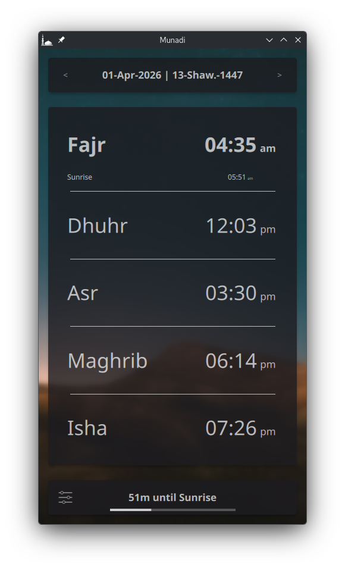
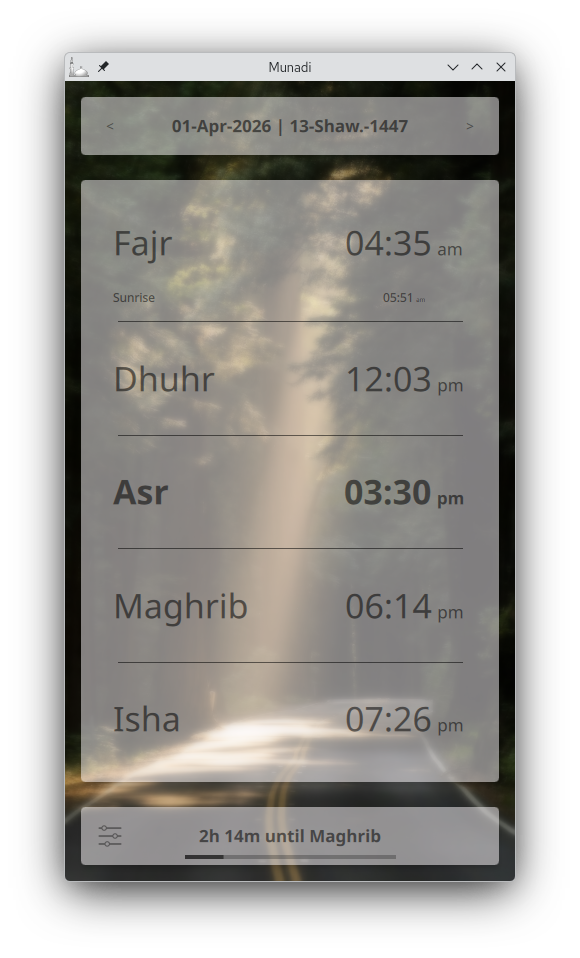
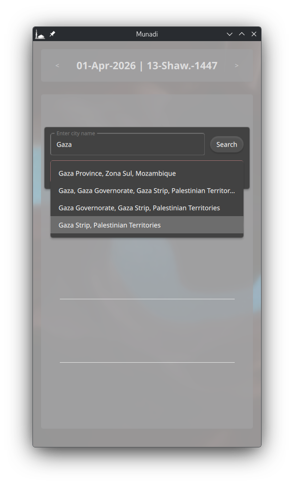
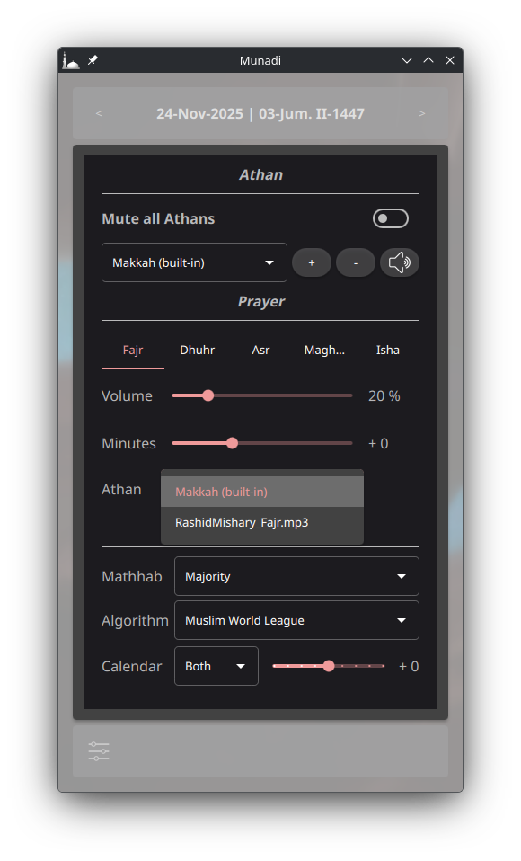

# Munadi

## Your Simple and Beautiful Athan App

Munadi is a simple yet powerful Athan app designed to be a companion in your daily life. It offers a clean, beautiful interface free from advertisements and tracking, delivering precise prayer alerts for any city worldwide. The app includes dual calendar support (Gregorian & Hijri), multiple calculation methods, and the ability to view prayer schedules for any date—past or future. A range of thoughtful settings allows you to tailor the experience to your personal needs.

**Features:**
- Prayer times for nearly any city around the globe
- Lightweight design with no advertisements or tracking
- Countdown to the next prayer, visible in tooltips
- View prayer times for past or future dates
- Automatic switching between Dark and Light themes
- Customizable UI visual effects
- Dynamic wallpapers that reflect the time of prayer
- Convenient system-tray support
- Flexible time format options
- Individual control to enable, mute, or adjust Athan volumes
- Option to assign a unique Athan for each prayer
- Fine-tune prayer times and Hijri date offsets
- Support for various global calculation methods

---

## Screenshots

### Version 26.06

<div style="overflow-x: auto; white-space: nowrap;">

|  |  |  |  |  |
|:--:|:--:|:--:|:--:|:--:|
| Fajr | Dhuhr | Asr | Maghrib | Isha |

|  |  |  |  |  |  |
|:--:|:--:|:--:|:--:|:--:|:--:|
| Material Light | Material Dark | Location Search | Prayer Times Settings | General Settings | Appearance Settings |

|  |  |
|:--:|:--:|
| Tray Menu | Tooltip |

</div>

---

## Status

| Packaging | Platform | Status |
|-----------|----------|:--:|
| Makeself  | linux/x86_64                  | [](https://gitlab.com/munadi/munadi/-/commits/26.06)                                                |
| Flatpak   | linux/x86_64<br>linux/aarch64 | [](https://github.com/flathub-infra/vorarbeiter/actions/workflows/build.yml) |
| APK       | android/arm64-v8a             | Alpha                                                                                                                                                                            |

> [!Note]
> The self-extracting makeself installer is the recommended distribution method. Flatpak is available but being deprecated.

---

## Installing

### Primary Release

**Munadi Self-Extracting Installer**

[](https://gitlab.com/munadi/munadi/-/releases)

No dependencies required - just download & install:

```bash
# Replace VER with the file's version, e.g. Munadi-26.06.run
$ sh Munadi-<VER>.run -q
```

Alternatively:

```bash
$ sh ./Munadi-<VER>.run
```

and follow instructions.

### Other Sources
<div align="center">
  <a href='https://flathub.org/apps/details/org.munadi.Munadi'>
    
  </a>
</div>

---

## Features

- Prayer times for cities worldwide with multiple calculation methods
- Hijri and Gregorian calendar display
- Customizable athan files and individual prayer volume control
- System tray integration with window show/hide functionality
- Time-left countdown to next prayer
- Time-of-day themed wallpapers
- Dark and light theme support
- RTL language support (including Arabic)

---

## Building from Source

Clone the repo:

```bash
git clone --recursive --depth 1 https://gitlab.com/munadi/munadi.git ./munadi_munadi && cd ./munadi_munadi
```

## 1. Static Build via Builder Image (Recommended)

The recommended method is to build a statically-linked app in the static-builder container:

**Docker:**
```bash
docker run --rm -it \
  --name munadi-builder \
  -v ./:/src:z,shared \
  registry.gitlab.com/munadi/munadi/static-builder:latest
```

**Podman:**
```bash
podman run --rm -it \
  --name munadi-builder \
  -v ./:/src:z \
  registry.gitlab.com/munadi/munadi/static-builder:latest
```

<details><summary>Further Developer Notes (Click to expand)</summary>

To build the image locally:

**Docker:**
```bash
# From project root
docker build -t munadi-builder pkg/docker/
docker run --rm -it \
  --name munadi-builder \
  -v ./:/src:z,shared \
  munadi-builder
```

**Podman:**
```bash
# From project root
podman build -t munadi-builder pkg/docker/
podman run --rm -it \
  --name munadi-builder \
  -v ./:/src:z \
  munadi-builder
```

This builds a custom image upon Rocky 10.1 UBI with necessary dependencies needed for building statically-linked Qt and FFmpeg libraries to-be-installed under `/usr`.

> [!CAUTION]
> Keep at least 50GB space free in your `/var/lib/containers` (`/var/tmp` or `$TMPDIR` if using podman) before building the image.

</details>

Then from inside the container:
```bash
#rm -rf ./build  # recommended housekeeping
cmake -S . -B build \
  --fresh \
  -G'Ninja Multi-Config' \
  -DCMAKE_BUILD_TYPE=Release
cmake --build build --parallel --config Release
cd pkg/makeself && ./generate_installer && cd -

# Pro tip: press up-arrow key to find these commands in history ;) 
```
A self-extracting archive named `Munadi-<ver>.run` with the built binary will be available under `pkg/makeself`. 

***For development purposes***: the built binary remains available under `build/Release`. To test standalone, execute from the host (outside container):
```bash
./build/Release/munadi
```

Other build types supported: `Debug`, `RelWithDebInfo`

As a healthy practice, always clean `~/.cache/Munadi` and `~/.config/munadi` folders across subsequent builds.

## 2. Build as Flatpak

### Prerequisites

**Build tools:**
- `ccache` (optional, for faster rebuilds)
- `cmake >= 3.30`
- `gcc-c++` or `clang++`
- `nasm`
- `ninja-build`
- `tar`
- `zstd`

**Libs: `<pkg>-devel` or `<pkg>-dev`**

> [!WARNING]
> Qt versions older than 6.9 may not be compatible. Build with project's latest tracking Qt version before filing bugs. Alternatively, [test build statically](#1-static-build-via-builder-image-recommended).

> [!NOTE]
> Generic package names are provided. These may not match on all distributions. Search your distribution's package repository for accurate package names.


- `qtbase`
- `qtshadertools`
- `qtdeclarative`
- `qtmultimedia`
- `qtpositioning`
- `qtsvg`
- `qtwayland`
- `qtlocation`
- `qtvirtualkeyboard`

- `libglvnd-devel`
- `libxkbcommon`
- `libXrandr`
- `openssl`
- `pipewire`
- `wayland`

The recommended method is to use `org.flatpak.Builder`:
```bash
# on project root
curl -fsORL https://github.com/flathub/org.munadi.Munadi/raw/refs/heads/master/org.munadi.Munadi.yml

flatpak install -y flathub org.flatpak.Builder

# Add the flathub repo user-wide
flatpak remote-add --if-not-exists --user flathub https://dl.flathub.org/repo/flathub.flatpakrepo

# Then build the manifest
flatpak run --command=flathub-build org.flatpak.Builder --install org.munadi.Munadi.yml

# Run the app (provided no previous installation of flatpak munadi is present)
flatpak run org.munadi.Munadi
```

<details><summary>Further Developer Notes (Click to expand)</summary>

There are three manifests already present under `pkg/flatpak`:
- **`org.munadi.Munadi.yml`** — Regular build using platform runtimes, closely resembling actual flathub manifest
- **`org.munadi.Munadi-static.yml`** — Statically-linked building from scratch for experimental sandbox builds
- **`org.munadi.Munadi-sfx.yml`** - Using latest pre-built [SFX archive](#-primary-release)

### Regular build
```bash
# Make the manifest available on repo root
ln -s pkg/flatpak/org.munadi.Munadi.yml

# Build the regular version with platform runtimes
flatpak-builder \
--verbose \
--force-clean \
--user \
--install-deps-from=flathub \
--ccache \
--repo=./repo ./builddir ./org.munadi.Munadi.yml

# Run the built app
flatpak-builder --run \
--env=WAYLAND_DISPLAY="$WAYLAND_DISPLAY" \
./builddir ./org.munadi.Munadi.yml munadi
```

### Static build
```bash
# Make the manifest available on repo root
ln -s pkg/flatpak/org.munadi.Munadi-static.yml

# Build static version with linked libraries
flatpak-builder \
--verbose \
--force-clean \
--user \
--install-deps-from=flathub \
--ccache \
--repo=./repo ./builddir ./org.munadi.Munadi-static.yml

# Run the built app
flatpak-builder --run \
--env=WAYLAND_DISPLAY="$WAYLAND_DISPLAY" \
./builddir ./org.munadi.Munadi-static.yml munadi
```

### SFX archive build
```bash
# Make the manifest available on repo root
ln -s pkg/flatpak/org.munadi.Munadi-sfx.yml

# Build static version with linked libraries
flatpak-builder \
--verbose \
--force-clean \
--user \
--install-deps-from=flathub \
--ccache \
--repo=./repo ./builddir ./org.munadi.Munadi-sfx.yml

# Run the built app
flatpak-builder --run \
--env=WAYLAND_DISPLAY="$WAYLAND_DISPLAY" \
./builddir ./org.munadi.Munadi-sfx.yml munadi
```

### Known Issues:
- Few core features like adding custom adhan doesn't work due to flatpak sandboxing. Alternatively, follow the [recommended workflow](#2-build-as-flatpak) for operating the app from a functional sandbox but introduces more clutter.

</details>

## 3. Qt Creator

Qt Creator can be used for debugging and developing the app standalone. It's especially powerful for UI developments.

### Prerequisites

> [!NOTE]
> Generic package names are provided. These may not match on all distributions. Search your distribution's package repository for accurate package names.

> [!WARNING]
> Qt versions older than 6.9 may not be compatible. Build with project's latest tracking Qt version before filing bugs. Alternatively, [test build statically](#1-static-build-via-builder-image-recommended).

- `qt-creator`

**Build tools:**
- `ccache` (recommended, for faster rebuilds)
- `cmake >= 3.30`
- `gcc-c++` or `clang++`
- `nasm`
- `ninja-build`
- *Optional:* `tar`
- *Optional:* `zstd`

**Libs: `<pkg>-devel` or `<pkg>-dev`**


- `qtbase`
- `qtshadertools`
- `qtdeclarative`
- `qtmultimedia`
- `qtpositioning`
- `qtsvg`
- `qtwayland`
- `qtlocation`
- `qtvirtualkeyboard`

- `libglvnd-devel`
- `libxkbcommon`
- `libXrandr`
- `openssl`
- `pipewire`
- `wayland`

After installing the packages, open `CMakeLists.txt` on project root in Qt Creator and build

***Tips:*** Build with `Debug` or `RelWithDebInfo` configuration for further debugging.

---

## Project Structure

```
.
./
├── android/                    # Android-specific build files
├── libs/                       # External libraries required for Munadi
│   └── KDSingleApplication/      # KDAB/KDSingleApplication submodule
├── pkg/                        # Configs and manifests for packaging and tool building
│   ├── android/                  # Android apk
│   ├── docker/                   # Builder images
│   ├── flathub/                  # Flatpak manifests
│   ├── makeself/                 # Makeself SFX archive
│   │   └── makeself/               # megastep/makeself submodule
│   └── snap/                     # Snap manifest
├── screenshots/                # App Screenshots
├── src/                        # App source files
│   ├── cpp/                      # C++ libs, engine, plugins and backends
│   ├── data/                     # Various resources
│   ├── i18n/                     # Translations
│   ├── img/                      # Image resources
│   ├── qml/                      # QML frontend
│   └── <redacted>                # Various other config files and icons
├── web/                        # Everything related to the homepage website
├── xdg/                        # XDG manifests, desktop files and icons
├── CHANGELOG.md                # Main tracked changes file
├── CMakeLists.txt              # App builder CMakeLists.txt
├── .gitlab-ci.yml              # CI/CD config
├── .gitmodules                 # List of project submodules
├── LICENSE                     # License
└── README.md                   # Read this first!!!!

```

---

## Versioning

Version format follows `YY.MM` convention (e.g., `21.04` for April 2021). Subsequent releases within same month follows `YY.MM.m` convention (e.g., `21.04.1` for another release on April 2021).

---

## Bug Reports

First of all, see if the issue you're facing already exists on the issue board. If not, follow these workflow before reporting bugs:

***If using self-extracting installer***

1. Install the app using the self-extracting archive:
```bash
MUNADI_DEBUG=1 sh Munadi-<ver>.run
```
Note the log location printed after (hopefully) successful installation. Retain it to a good place.

2. Remove old configs and caches:
```bash
rm -rf ~/.cache/Munadi
mv ~/.config/munadi{,.bak}
```

3. Do
```bash
QT_LOGGING_RULES='*.debug=true;qt.*.debug=false' munadi > munadi.log 2>&1
```

and try reproducing the issues

***If using flatpak version***

1. Run `flatpak update --appstream` and `flatpak update -y`
2. Remove old configs and caches:
```bash
mv ~/.var/app/org.munadi.Munadi{,.bak}
```
3. Run from terminal:
```bash
flatpak run --command=munadi --env=QT_LOGGING_RULES='*.debug=true;qt.*.debug=false;kf.*.debug=false' org.munadi.Munadi > munadi-log.txt 2>&1
```
and try reproducing the issues.

If issues persist, [open an issue](https://gitlab.com/munadi/munadi/-/issues) with `munadi.log`, the install logs you retained earlier and the one in the CWD when installing. Explain as detail as possible with your current app version and relevant distro details.

---

## Contributing

- Test in both static build and regular. Use builder image for reproducible environments.
- Test all packagings
- Update `CHANGELOG.md` and XDG metainfo with notable changes. 
- Validate the metainfo file
```bash
appstreamcli validate /path/to/your.metainfo.xml
```
- Use `./gen_whatsnew` to also update What's new front page.
- Maintain [versioning scheme](#versioning)
- [Submit a merge request](https://gitlab.com/munadi/munadi/-/merge_requests/new) to master branch

For flatpaks:
- Validate your manifest first:
  ```bash
  flatpak run --command=flatpak-builder-lint org.flatpak.Builder manifest /path/to/your/manifest
  ```
> [!NOTE]
> Make sure your manifest uses [latest tagged commit of the project](https://gitlab.com/munadi/munadi/-/tags) as the source. Do not use other commits as those are not guaranteed to be stable.

- Then your AppStream metainfo:
  ```bash
  flatpak run --command=flatpak-builder-lint org.flatpak.Builder metainfo /path/to/your.metainfo.xml
  ```

- Then test build and install [following the recommended workflow](#2-build-as-flatpak). Replace with your manifest.

- Additionally, check your repo after building
  ```bash
  flatpak run --command=flatpak-builder-lint repo repo
  ```

Contributions are also warmly accepted on [flathub repository](https://github.com/flathub/org.munadi.Munadi).

## AI Contribution Policy

We try to be as clear as possible on AI agent, LLM and bot contributions to the project. AI-assisted contributions by humans are welcome, any other autonomous AI contributions including merge/pull requests, issues & comments will be rejected. This includes any variants of `"Signed-off by <agent's operator>`" i.e. human-operated agentic requests. We encourage both seasoned and new-comer (human) contributors to include `"Assisted by: "` footer whenever presenting any contributions on the project if using any assistances by AIs & LLMs.

---

## License

This project is licensed under the AGPL-3.0-or-later license. FFmpeg is built on the default LGPL license. Licenses apply to individual tools used in this project. See the [LICENSE](LICENSE) file for details.

---

- **Homepage**: [munadi.org](https://munadi.org)
- **Bug Tracker**: [Issues](https://gitlab.com/munadi/munadi/-/issues) | [Flathub Issues](https://github.com/flathub/org.munadi.Munadi/issues)
- **Source Code**: [Source](https://gitlab.com/munadi/munadi) | [Flathub](https://github.com/flathub/org.munadi.Munadi)

---

*For historical context, see the [CHANGELOG](CHANGELOG.md).*
